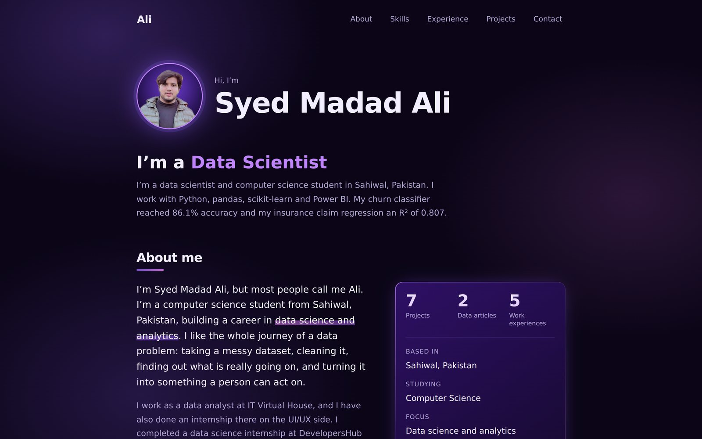
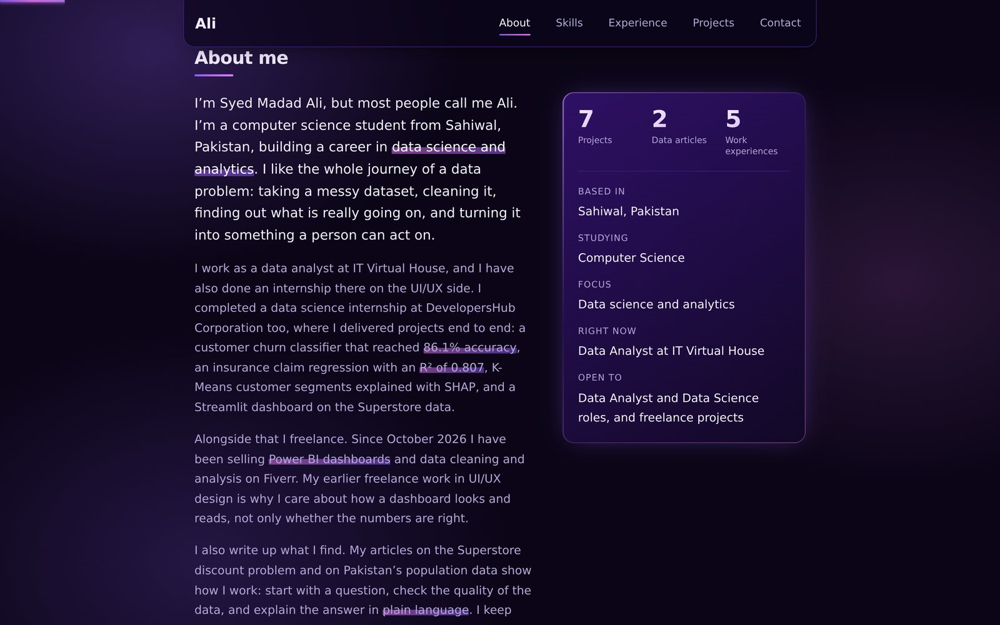
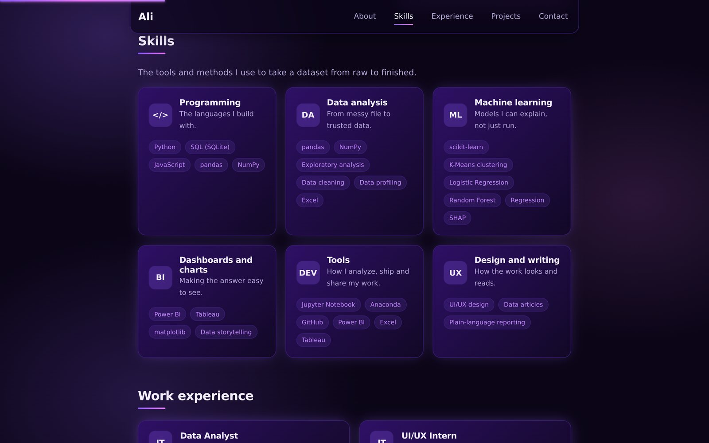
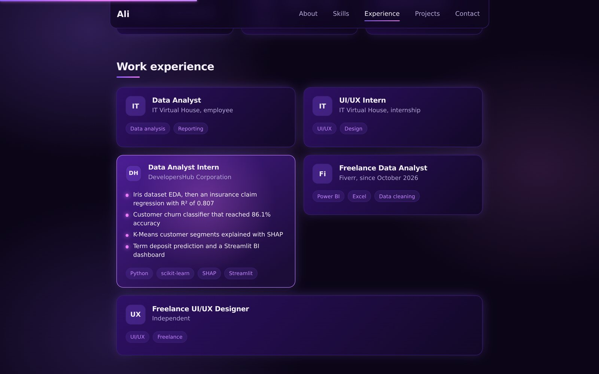
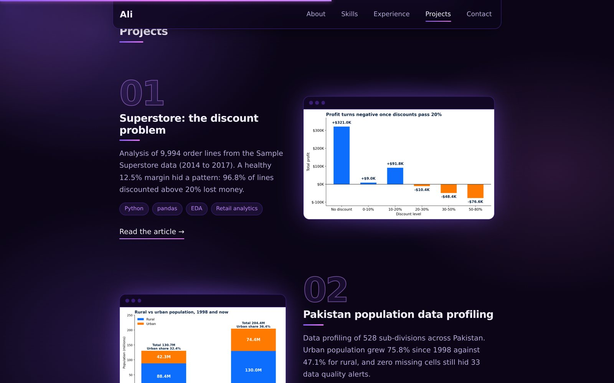
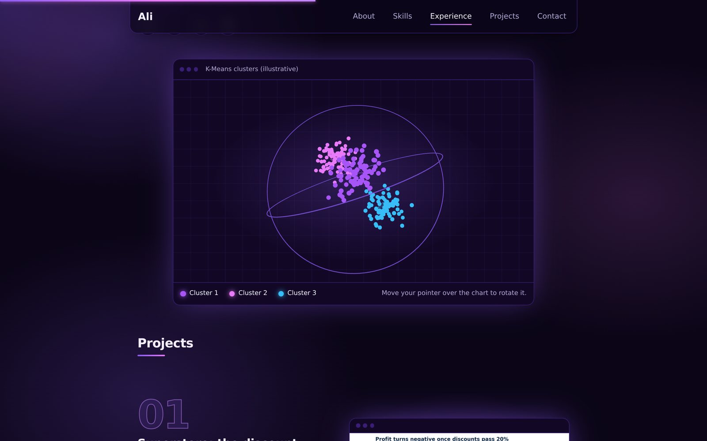
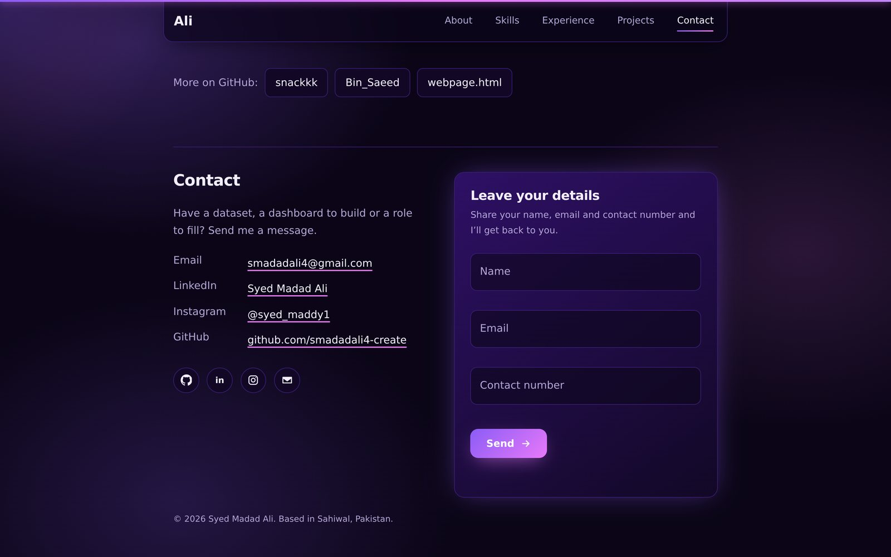
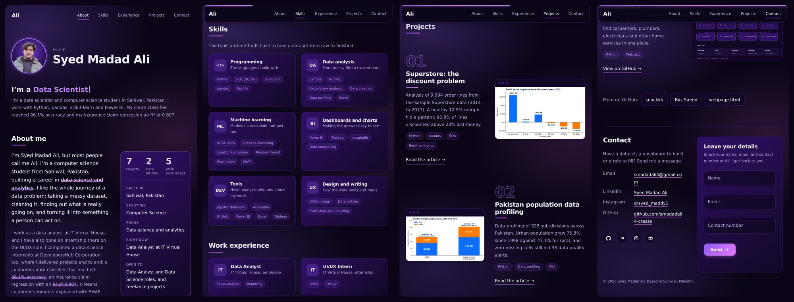
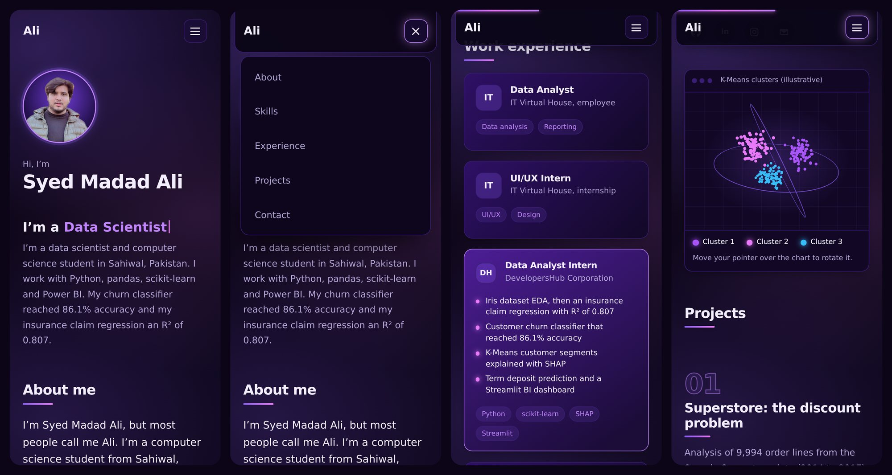
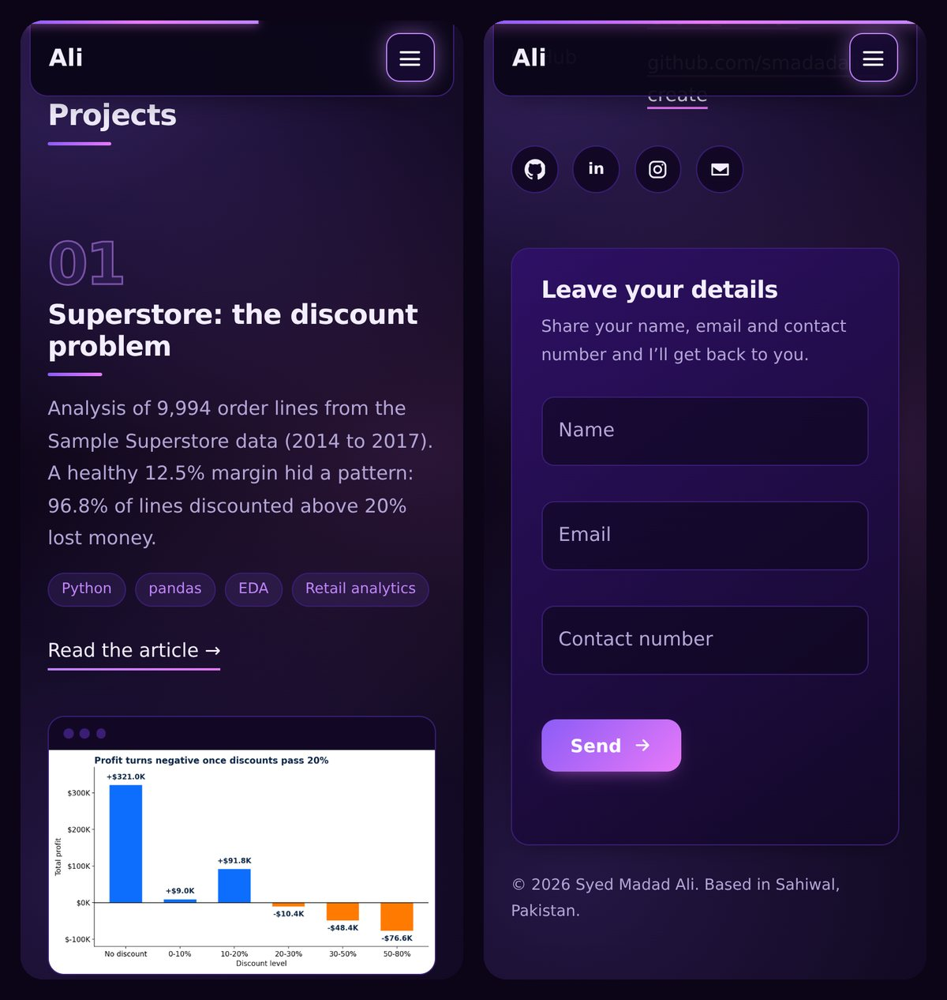

# Syed Madad Ali: Data Science Portfolio

A fast, responsive personal portfolio for a data analyst and data science student. It is plain HTML, CSS and JavaScript with **no build step and no folders**, so it can be hosted for free on GitHub Pages.

**Live site:** https://smadadali4-create.github.io/Syed-Madad-Ali-Portfolio/



## Screenshots

### Desktop

| About me | Skills |
| --- | --- |
|  |  |

| Work experience (card flipped by hovering) | Projects |
| --- | --- |
|  |  |

| 3D K-Means cluster chart | Contact form |
| --- | --- |
|  |  |

### Tablet (iPad mini)



### Phone (iPhone 15)

On phones the menu becomes a three-line button, and experience cards flip with a tap.





## Features

- **Responsive from 320 px to full HD.** The layout reflows for phones, tablets and desktops, with no sideways scrolling. The menu shows every link on tablets and collapses into a three-line button on phones.
- **Everything is edited in one file.** Name, typing roles, About me, skills, experience, projects and links all live in `content.js`.
- **Work experience cards** flip in 3D to show details. Hover on a desktop, tap on a phone, or use Enter and Escape on a keyboard. Each card keeps its own space, so cards never overlap.
- **Project previews** are real charts and dashboards. Clicking a picture opens the project's main link (GitHub repo or PDF article).
- **3D K-Means cluster chart** drawn with three.js, framed so the whole chart is always visible.
- **Contact form** with name, email and contact number, with validation and a spam trap.
- **Smooth, calm motion.** Content fades in on scroll, the layout glides when the window is resized, and a scroll progress bar sits at the top.
- **Accessible.** Keyboard navigation, visible focus, proper labels, and "reduce motion" is respected.

## Built with

HTML, CSS, JavaScript, [three.js](https://threejs.org/) (3D chart, loaded from a CDN) and Google Fonts (Sora and DM Sans). No framework and no build tools.

## Files

All files sit together in one folder, with no sub-folders, so they are easy to upload.

| File | What it is |
| --- | --- |
| `index.html` | The page itself |
| `style.css` | All styling, colors and fonts |
| `content.js` | **Your content: edit this file** |
| `main.js` | Fills the page from `content.js`, plus menu, flip cards, form and animations |
| `scene.js` | The 3D K-Means cluster chart |
| `404.html` | Page shown for a wrong address |
| `profile.jpg` | Your photo |
| `favicon.svg`, `og-image.png` | Browser tab icon and the picture shown in link previews |
| `superstore-discounts.png`, `pakistan-population.png`, `tips-dashboard.png`, `titanic-dashboard.png`, `internship-churn-model.png`, `internship-customer-segments.png`, `proservex-flow.png` | Project pictures |
| `Superstore_Data_Article.pdf`, `Pakistan_Population_Data_Article.pdf` | The two data articles |
| `screenshot-*.jpg` | Screenshots used by this README (safe to delete) |
| `README.md` | This file |

## Run it on your computer

1. Install [VS Code](https://code.visualstudio.com/) and open this folder (**File > Open Folder**).
2. Install the **Live Server** extension (VS Code suggests it).
3. Right-click `index.html` and choose **Open with Live Server**. The page reloads each time you save.

No extension? Run `python -m http.server 8000` in this folder and open <http://localhost:8000>.

## Customize

Almost everything you will change is in **`content.js`**.

| What | Where in `content.js` |
| --- | --- |
| Name, photo, typing roles, short summary | top of the file (`name`, `photo`, `roles`, `summary`) |
| Email, LinkedIn, Instagram, GitHub | `links` |
| About me paragraphs, quick facts and counters | `about` (wrap a phrase in `**double asterisks**` to highlight it) |
| Skill cards | `skills` |
| Work experience cards and the details on their back | `experience` |
| Projects (picture, text, links) | `projects` |
| Extra GitHub buttons | `more` |
| Contact form behaviour | `form` |

- **Change your photo:** replace `profile.jpg` with a square image (about 560 x 560 px), keeping the same file name.
- **Use a real screenshot for a project:** put the image in the same folder as `index.html` and set `image: "your-file.png"` on that project. Use a wide image of at least 1600 px so it stays sharp on phones and retina screens.
- **Change colors and fonts:** they are variables at the top of `style.css`.

## Contact form

A static site has no server, so the form works in one of two ways:

- **Default:** pressing Send opens the visitor's email app with their name, email and number filled in, addressed to the email in `links.email`.
- **Straight to your inbox:** create a free form at [Formspree](https://formspree.io) (or Web3Forms), copy its address, and paste it into `form.endpoint` in `content.js`. Submissions then arrive by email without the visitor leaving the page.

## Deploy on GitHub Pages

1. On GitHub, click **New repository**, name it (this site uses **`Syed-Madad-Ali-Portfolio`**) and set it to **Public**.
2. Put the files in the repo. **`index.html` must be at the top level of the repo.** Because there are no folders, this is easy:
   - *Without Git:* on the repo page click **Add file > Upload files**. Open this folder on your computer, press `Ctrl + A` (select all files), and drag them onto the page, or click **choose your files** and select them all. Wait until every file is listed, then click **Commit changes**.
   - *With Git or VS Code:*

     ```bash
     git init
     git add .
     git commit -m "Add portfolio"
     git branch -M main
     git remote add origin https://github.com/smadadali4-create/Syed-Madad-Ali-Portfolio.git
     git push -u origin main
     ```

     In VS Code you can also use **Source Control > Initialize Repository > Publish to GitHub**.
3. Open **Settings > Pages**. Under **Build and deployment** choose **Deploy from a branch**, pick **main** and **/ (root)**, then **Save**.
4. Wait one to three minutes. GitHub shows "Your site is live at ..." on that page.

**Updating the site:** edit a file, commit and push (or upload it again, which replaces the old one). The change is live in about a minute. Press `Ctrl + F5` if you do not see it.

**Prefer a shorter address?** Name the repo `smadadali4-create.github.io` instead and the site opens at `https://smadadali4-create.github.io/`. Then update the `og:url` and `og:image` lines in `index.html` so link previews use the new address.

**Custom domain:** buy a domain, then add it under **Settings > Pages > Custom domain** and follow GitHub's DNS steps.

**If something looks wrong:** a plain, unstyled page with no text means `style.css`, `content.js` or `main.js` is missing from the repo, so check that every file in the table above is listed on the repo page. A 404 means `index.html` is not at the top level. Missing pictures mean a file name differs, including capital letters, because GitHub is case-sensitive. The **Actions** tab shows whether the Pages build finished.

## Checked on

Layout, images and console errors were checked in Chromium at 320, 360, 375, 390, 430, 744, 768, 820, 1024, 1133, 1180, 1366, 1440 and 1920 px wide, covering iPhone SE to Pro Max, iPad mini, iPad Air and iPad Pro in portrait and landscape, laptops and full HD. At every size the page has no sideways scrolling, the project pictures are at least as sharp as the screen needs, and there are no console errors. It is still worth a quick look on your own phone after deploying.

## Credits

- [three.js](https://threejs.org/) for the 3D chart.
- Fonts: [Sora](https://fonts.google.com/specimen/Sora) and [DM Sans](https://fonts.google.com/specimen/DM+Sans) from Google Fonts.
- Project charts come from my own analyses: Sample Superstore, Pakistan population data, Tips and Titanic in Power BI, and my DevelopersHub Corporation internship notebooks.

## Author

**Syed Madad Ali** - Computer Science student in Sahiwal, Pakistan, focused on data science and analytics.

- Email: [smadadali4@gmail.com](mailto:smadadali4@gmail.com)
- LinkedIn: [syed-madad-ali](https://www.linkedin.com/in/syed-madad-ali-6760192a4/)
- Instagram: [@syed_maddy1](https://www.instagram.com/syed_maddy1/)
- GitHub: [smadadali4-create](https://github.com/smadadali4-create)
